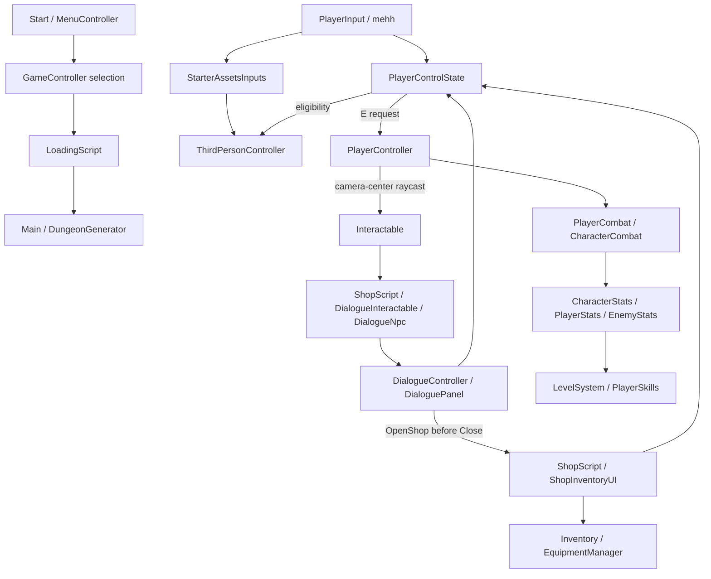

# Architecture

Current boundaries; inspect source and serialized references before changing them. [Context](PROJECT_CONTEXT.md) owns status, [roadmap](DEVELOPMENT_ROADMAP.md) pending work, [index](SCRIPT_INDEX.md) locations.

## Runtime ownership

PlayerControlState owns cursor visibility/lock and gameplay eligibility, considering focus, death, timeScale, inventory, chest, shop and dialogue. Consumers retain subscriptions but respect that state. Dialogue also cancels in-flight player combat. Do not add a competing locomotion/camera/input owner or duplicate E polling for NPC interaction. Retained legacy/demo pollers are not templates for new input.

Pause is separate from modal UI: SettingsMenu uses timeScale=0; dialogue/inventory/trading block player input while the world continues. During dialogue, E/Tab are ignored and Escape closes. Shop/chest interaction closes on E or Escape without also pausing in that press. Older plans requiring Escape always to pause are superseded for these contexts.

## Data and interaction

Item/Equipment/Consumable, Class, Enemy, WeaponClass/Abilities and DialogueConversation/actions are ScriptableObject definitions. Inventory/equipment/conversation/progression runtime state belongs to components/models, not shared dialogue assets. A runtime item-instance/quantity/persistence model is not implemented.

Interactable is shared by pickups, doors, chests, shops, enemies, exits and dialogue adapters. PlayerController looks from camera center, ignores trigger hits and its own layer, resolves GetComponentInParent<Interactable>, checks the configured player distance (default 4), focuses and calls Interact(owner). Interactable.radius is not that raycast's distance authority.

ShopScript optionally delegates Interact to DialogueNpc. OpenShop bypasses that route and selects an explicit UI or the interacting player's PlayerControlState.ShopUI. ShopUI activates before dialogue releases control, preventing a gameplay frame between panels. Shops without dialogue retain direct interaction.

OpenBank/StartQuest/OpenService are **request hooks only**. Future modal handlers must establish input ownership before releasing dialogue. PlayerControlState knows concrete inventory/chest/shop/dialogue surfaces, not arbitrary future service panels; a generic modal lease/service adapter is not implemented.

## Combat, world and progression

CharacterCombat owns timelines/cooldowns/block/recovery. PlayerCombat exposes light attacks only; animation busy state no longer owns player locomotion. Active shield reduction remains in CharacterCombat, with final armor/minimum health loss in CharacterStats; see [combat](SYSTEMS/Combat.md). AttackHitBox/Projectile acquire contacts; CharacterStats owns final armor/health/death; CharacterAnimator owns presentation. EnemyAi is an Update-driven FSM with throttled perception/pathfinding, configured by EnemyStats.Definition. Preserve these responsibilities rather than adding competing damage/movement authorities.

DungeonGenerator owns the graph, room assembly, current NavMesh, generation state and floor advancement/rollback. Runtime custom navigation uses Unity.AI.Navigation; the legacy NavMeshComponents vendor tree remains separate. Physical path validation is distinct from graph tests.

PlayerStats owns player XP/skills. Player delegates to co-located PlayerStats, retaining a standalone demo fallback. LevelSystemAnimatedUpdater is local and disposed explicitly; CodeMonkey FunctionUpdater no longer drives it.

## Serialization and tooling

Organization retained class names, namespaces, serialized fields, enum ordering, GUIDs and Assembly-CSharp/Assembly-CSharp-Editor boundaries. No asmdefs were added. Editor-only code stays in Editor folders; script-run builders remain outside Assets. Vendor/Starter Assets paths were retained. [Maintenance](MAINTENANCE.md) records scene/output path corrections and validation.

## Quest integration (2026-11-13)

QuestController/QuestService own per-player quest state; immutable QuestDefinition assets describe content. Existing DialogueController/Panel evaluate DialogueCondition and QuestDialogueAction against that service. Inventory exposes generic atomic exchanges; it does not depend on quest code. Enemy_Main carries QuestEnemyBridge; NPC_Main is its friendly prefab variant with hostile components disabled. PlayerHolder owns the quest controller and uGUI journal; PlayerControlState retains modal/input authority. See [quests](SYSTEMS/Quests.md) for implemented boundaries and the quest-only JSON persistence limitation.

Minimap presentation is owned by MapController on PlayerHolder HUD; it follows the player through the existing MapCamera. PlayerControlState owns Map/M and Escape gating; expanded mode blocks gameplay without pausing. See [minimap](SYSTEMS/Minimap.md).

Merchant integration (2026-11-13): immutable ShopDefinition assets configure rules/prices/restock; ShopInventory owns per-merchant quantities and atomic trading through Inventory.TryExchange. Inventory owns player gold. Existing ShopInventoryUI and slots present 3x3 stock/paged bag selling; PlayerControlState and dialogue retain modal ownership. All economy state is session-only. See [shops](SYSTEMS/Shops.md).

## Resource gathering (2026-11-13)

ResourceNode extends Interactable; ResourceNodeDefinition and ResourceNodeRequirement hold configuration, while each node owns reservations, charges and scaled respawn deadlines. PlayerGathering owns a timed action on the existing player and acquires an exclusive PlayerControlState action lease. Gameplay eligibility still includes all existing modal/focus/death checks, so releasing a gathering lease cannot release another system's lock. CharacterAnimator owns gathering-state presentation and restoration; PlayerController and GatheringProgressHUD present feedback on the existing Canvas. Inventory.TryExchange commits the whole reward before state/observer notifications. Existing quest possession objectives receive the normal inventory notification; cumulative gathering is an event extension point, not a new quest owner. See [resource nodes](SYSTEMS/ResourceNodes.md) for setup, validation and session-only persistence limits.

Resource-delivery quest integration (2026-11-13) retains those boundaries: ResourceNode -> Inventory.NotifyExchange -> QuestController/QuestService PossessItem facts -> existing dialogue/journal. No gathering dependency is added to QuestService and no quest dependency is added to ResourceNode. PlayerHolder registers both authored adventures; Quartermaster_Nessa derives from NPC_Main. Dialogue buttons carry their originating node and presentation version so deferred old-stage/session callbacks cannot execute a different current-stage action. See [quests](SYSTEMS/Quests.md#gathering-adventure-integration-2026-11-13) and [dialogue](SYSTEMS/Dialogue.md).

## Independent skill progression (2026-11-13)

PlayerSkillProgress is the per-player owner of ten independent XP totals alongside PlayerStats' existing character XP/unlock tree. SkillDefinition/SkillXpCurve are immutable shared configuration. PlayerGathering awards only after committed rewards; melee/projectile contacts measure actual hostile enemy health loss; CharacterCombat reports successful blocks. Skillbook reuses Item.Use and commits exact-slot consumption before XP observers; SkillFeedbackHUD listens on the existing UICanvas with no input authority. Versioned snapshot data is available, but coordinated gameplay disk saving remains unimplemented. See [Skills](SYSTEMS/Skills.md).

## Temporary status effects (2026-11-13)

StatusEffectDefinition is shared configuration; StatusEffectController owns per-entity snapshots/timers and exposes events/query APIs. CharacterStats retains health/armor/death and exposes derived modifiers; CharacterCombat consumes effective damage, ThirdPersonController and EnemyAi consume effective movement. Consumable optionally applies effects through the shared controller; StatusEffectHUD presents them on the existing UICanvas without input ownership. PlayerHolder/Enemy_Main and Combat_Test are wired; temporary effects are session-only. See [status effects](SYSTEMS/StatusEffects.md).

Item.worldPrefab optionally supplies a complete world pickup for EquipmentManager.TryDropItem; UISlot removes its exact source entry only after successful creation. Equipment retains the original mesh-based fallback. Poison Potion owns an independent pickup prefab while reusing potion art; see [inventory](SYSTEMS/Inventory.md).
