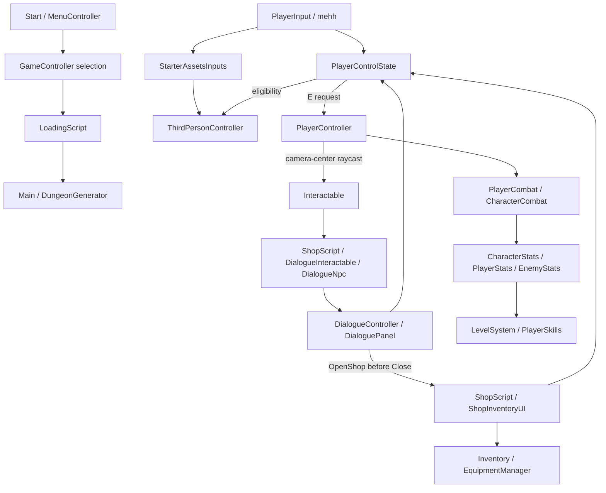

# Architecture

Current boundaries; inspect source and serialized references before changing them. [Context](PROJECT_CONTEXT.md) owns status, [roadmap](DEVELOPMENT_ROADMAP.md) pending work, [index](SCRIPT_INDEX.md) locations.

## Runtime ownership

PlayerControlState owns cursor visibility/lock and gameplay eligibility, considering focus, death, timeScale, inventory, chest, shop and dialogue. Consumers retain subscriptions but respect that state. Dialogue also cancels in-flight player combat. Do not add a competing locomotion/camera/input owner or duplicate E polling for NPC interaction. Retained legacy/demo pollers are not templates for new input.

Pause is separate from modal UI: SettingsMenu uses timeScale=0; dialogue/inventory/trading block player input while the world continues. During dialogue, E/Tab are ignored and Escape closes. Shop/chest interaction closes on E or Escape without also pausing in that press. Older plans requiring Escape always to pause are superseded for these contexts.

## Data and interaction

Item/Equipment/Consumable, Class, Enemy, WeaponClass/Abilities and DialogueConversation/actions are ScriptableObject definitions. Inventory/equipment/conversation/progression runtime state belongs to components/models, not shared dialogue assets. A runtime item-instance/quantity/persistence model is not implemented.

Interactable is shared by pickups, doors, chests, shops, enemies, exits and dialogue adapters. PlayerController looks from camera center, ignores trigger hits and its own layer, resolves GetComponentInParent<Interactable>, checks the configured player distance (default 4), focuses and calls Interact(owner). Interactable.radius is not that raycast's distance authority.

ShopScript optionally delegates Interact to DialogueNpc. OpenShop bypasses that route and selects an explicit UI or the interacting player's PlayerControlState.ShopUI. ShopUI activates before dialogue releases control, preventing a gameplay frame between panels. Shops without dialogue retain direct interaction.

OpenBank/StartQuest/OpenService are **request hooks only**. Future modal handlers must establish input ownership before releasing dialogue. PlayerControlState knows concrete inventory/chest/shop/dialogue surfaces, not arbitrary future service panels; a generic modal lease/service adapter is not implemented.

## Combat, world and progression

CharacterCombat owns timelines/cooldowns/block/recovery. AttackHitBox/Projectile acquire contacts; CharacterStats owns final armor/health/death; CharacterAnimator owns presentation. EnemyAi is an Update-driven FSM with throttled perception/pathfinding, configured by EnemyStats.Definition. Preserve these responsibilities rather than adding competing damage/movement authorities.

DungeonGenerator owns the graph, room assembly, current NavMesh, generation state and floor advancement/rollback. Runtime custom navigation uses Unity.AI.Navigation; the legacy NavMeshComponents vendor tree remains separate. Physical path validation is distinct from graph tests.

PlayerStats owns player XP/skills. Player delegates to co-located PlayerStats, retaining a standalone demo fallback. LevelSystemAnimatedUpdater is local and disposed explicitly; CodeMonkey FunctionUpdater no longer drives it.

## Serialization and tooling

Organization retained class names, namespaces, serialized fields, enum ordering, GUIDs and Assembly-CSharp/Assembly-CSharp-Editor boundaries. No asmdefs were added. Editor-only code stays in Editor folders; script-run builders remain outside Assets. Vendor/Starter Assets paths were retained. [Maintenance](MAINTENANCE.md) records scene/output path corrections and validation.
