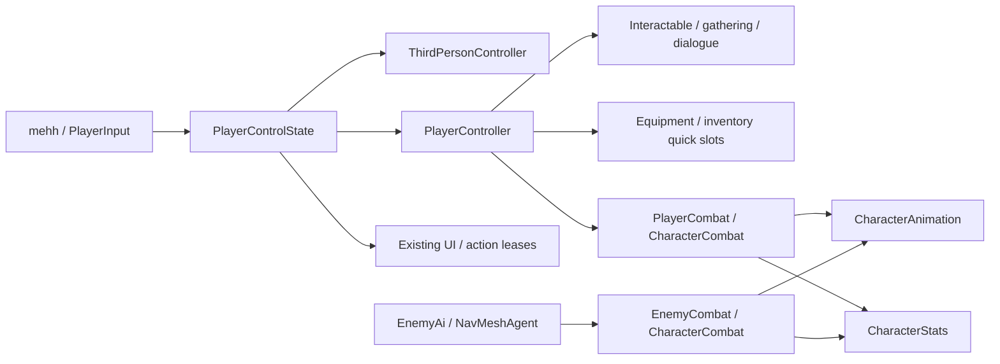

# Player architecture

Implemented 2026-11-15. Scope: **PlayerHolder and its nested Player_Main character**. [Cleanup report](Player_Cleanup_Report.md) owns the inventory, measurements, migration and executed checks; [technical debt](Character_Technical_Debt.md) owns remaining character work. All plans live under Assets/Plan.

## Composition and ownership

PlayerHolder is the playable aggregate: UI, EventSystem, cameras, minimap and the nested Player_Main prefab. The user's new Player_Main extraction and PlayerContent move into Variants are preserved. A holder instance can retain the name `Player` for the nested character. Player_Main is a reusable character asset, not a complete standalone scene/UI bootstrap. Cross-hierarchy camera, HUD and modal references are holder overrides; retain those when creating another holder.

| Component | Responsibility | Integration |
| --- | --- | --- |
| PlayerInput | Unity Input System device/action-map lifecycle | `Assets/Input/mehh.inputactions`, InvokeCSharpEvents |
| PlayerControlState | Collect intentions; route UI keys; own cursor, focus/modal/death eligibility and gathering leases | Only gameplay subscriber to PlayerInput.onActionTriggered; Move/Look/Sprint/BlockHeld plus InteractRequested/GameplayActionRequested |
| StarterAssets.ThirdPersonController | Sole CharacterController.Move, player rotation, grounded/gravity, walk/sprint acceleration, locomotion parameters and camera mode/orbit owner | Lives in Scripts/Player; original namespace/class/GUID retained; reads intentions; consumes status MovementMultiplier; mouse/view yaw owns facing, interaction focus does not steer it |
| PlayerController | Dispatch attack, equipment, quick-slot, grabbing and camera-center interactions; maintain focus/resource prompt | Sends requests to existing executors; never writes position/rotation; public EnableMovement/DisableMovement callbacks forward to the motor |
| PlayerCombat / CharacterCombat | Player shield/projectile adapter / shared attack timeline, damage windows, cooldown, cancellation and recovery | Light-only player requests; no locomotion authority; NPC heavy data remains supported |
| CharacterAnimation | Shared player/NPC authored action playback, animation busy state, hit/death, equipment grip and gathering presentation | Replaces empty PlayerAnimator/EnemyAnimator subclasses; player attack busy state never changes movement flags |
| CharacterStats / PlayerStats / EnemyStats | Shared health, armor, equipment subscription/modifiers, healing and death state / player UI, XP, class equipment and restart / enemy tuning, attribution and loot | Shared layer has no player input or EnemyAi dependency; EnemyStats owns its AI notification |
| CharacterEquipment + PlayerEquipment | Shared gear/mesh state + player slot presentation | U is dispatched only to the interacting player; NPC gear no longer polls player keys |
| Inventory | Existing fixed-slot items and transactions | Existing item, chest, quest, gathering and shop contracts retained |
| PlayerGathering | Timed resource execution and owner-checked lease | Existing animation/reward/cancellation path retained |
| DialogueController, QuestController, PlayerSkillProgress, StatusEffectController | Independent existing gameplay domains | Retained; do not merge progression, conversation graphs or effects into movement |
| PlayerContent | Holder/menu class/name bootstrap | Retained because GameController and menu scenes reference the aggregate; never controls input/movement |
| HotKeysUI, UI_SkillTree | Shortcut slot configuration/icon presentation; skill-tree presentation | Quick slots execute on PlayerController requests even when HUD objects are hidden. Skill tree binds PlayerStats directly when opened; UI-only demo creates its own PlayerSkills model. |

## Input and movement contract

Existing WASD/stick, mouse/stick look, Shift sprint, V view mode, mouse light attack/shield, E interaction, Tab inventory, Escape pause/close/cancel, J journal and M map remain. Q grabbing, U unequip and 1–6 quick slots now use the same project action map. UI response navigation remains the EventSystem's domain; dialogue numeric response shortcuts and presentation pointer tracking are UI input, not competing character controls.

PlayerControlState resets intentions at focus/modal/death/disable boundaries. A held button must be released before a fresh gameplay action after that boundary. Cancellation is processed even while gameplay is blocked. Gathering retains its exclusive lease without pausing or releasing the cursor; releasing a lease cannot override a still-open modal.

The motor uses bounded horizontal acceleration/braking, gravity integration/substeps and one grounded probe. UI gating stops horizontal input while gravity continues. Both modes face view yaw; third-person smooths the turn. Directional keys move/strafe relative to that yaw and never choose facing. Camera target rotation is applied after character facing so parent rotation cannot add an extra frame of yaw. Combat and actions do not rotate the player independently.

Jumping, jump buffer/coyote/cooldowns, player heavy attacks and player slide paths are absent. Free fall/grounding remain, including an InAir → Empty landing transition. Shared NPC heavy clips, weapon data and NPC controller are retained. PlayerCombat's inherited `Attack(bool)` callback normalizes old `true` callers to a light attack; this is a safety boundary, not a player heavy mechanic.

## Extending the character

Add authored actions to mehh and route intentions through PlayerControlState. Put a new action's execution in an existing cohesive gameplay owner where possible. Keep equipment, health, combat timelines, animation presentation and NPC navigation shared in their existing components. Future combat replacement should consume the same input requests and CharacterStats contracts; it should not require another input/movement rewrite.

Keep Player_Main source identity and the holder's external overrides together. Test the playable PlayerHolder aggregate after changing a nested source. Never reintroduce independent player rotation, grounded flags, raw gameplay key polling or animation events that duplicate CharacterCombat damage timing. Old NavMesh/tutorial/demo controllers are outside this production architecture and remain only where their legacy assets still reference them.

## Equipment/animation follow-up

Current ownership is defined by [Inventory](SYSTEMS/Inventory.md#equipment-and-weapon-ownership--2026-11-15) and [Animation](SYSTEMS/Animation.md#explicit-weapon-motions--2026-11-15): CharacterEquipment owns items/visuals and the explicit active WeaponAttackSet, CharacterCombat selects/captures an AttackMotion, and CharacterAnimation plays it. The original cleanup report is historical evidence for the preceding pass; its former default/replacement-clip architecture is superseded. Source/asset GUIDs and the user's nested Player_Main structure are preserved through the five script renames.

Camera follow-up (2026-11-15): the single motor-driven StablePlayerViewTarget feeds both camera modes; the duplicate third-person camera is disabled. Directional locomotion uses MoveX/MoveY child blends inside the existing speed tree. Current configuration, 36 focused checks and the unsaved-scene handoff are owned by [Player](SYSTEMS/Player.md#mouse-facing-third-person-camera--implemented-2026-11-15).
