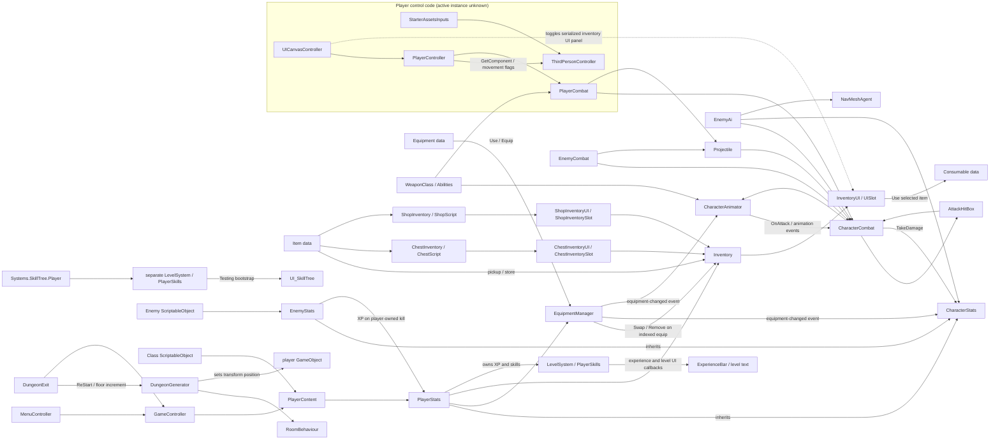

# Complete Codebase Audit

**Audit date:** 2026-11-08
**Unity version:** 6000.3.28f1
**Scope:** C# code and code-related package/version declarations only

## 1. Executive summary

This is an established Unity prototype with recognizable building blocks for third-person movement, combat, enemies, equipment, inventory, loot, progression, destructible objects, and procedural dungeon generation. It is not a blank project and does not need a ground-up replacement. The main architectural direction—ScriptableObject definitions, shared character stats/combat, reusable equipment managers, and a common interactable base—is a useful starting point.

The code is not yet a dependable end-to-end RPG loop. The most consequential source-level findings are:

1. The player inventory is created with capacity but no slots; its normal `Add` path therefore finds no free slot. Several callers also fail to handle a rejected add, including chest looting.
2. The normal (non-ability) projectile path does not initialize projectile damage or range. Ability projectiles do.
3. There are two independent player progression/skill state objects. Enemy XP updates `PlayerStats`, while the skill-tree bootstrap passes the separate `Player` object's skills to the UI.
4. Equipment-change notifications are not consistent: the overload used for direct equipment changes invokes callbacks before the new equipment is registered, and invokes two callbacks on replacement.
5. Damage/defence behavior differs across melee, projectile, and blocking paths. Blocking subtracts armor before calling stats, where armor is subtracted again; hit animation is also requested twice on the unblocked combat path.
6. Movement and input code is split across a Starter Assets controller, a custom player controller, older first-person code, and demo controllers. In particular, movement-enable flags are written by the custom controller but never read by the Starter Assets controller.
7. Dungeon-generation retry and start/end selection use unbounded recursion, and room quotas are mutated without being reset on regeneration.

These are source findings, not claims about which components are active in a particular scene. Serialized references, live prefab composition, scene use, and Play Mode behavior were intentionally not examined.

## 2. Scope, evidence, and limits

### Included

- Catalogued **210 C# files under `Assets`**:
  - `Assets/Scripts`: 104
  - `Assets/Plugins`: 99
  - `Assets/GamePlay`: 4
  - `Assets/Prefabs/Player/DemoPlayer`: 3
- Read `Packages/manifest.json` and `ProjectSettings/ProjectVersion.txt` for package/version context.
- Traced source-level calls among controllers, stats, combat, inventory/equipment, progression, enemy AI, dungeon generation, UI, and third-party integrations.

### Excluded by instruction

- No scenes, prefabs, ScriptableObject assets, materials, input-action asset contents, or other serialized Unity assets were inspected.
- No Unity Editor, batch-mode validation, or Play Mode testing was performed.
- The project was not modified except for creating this requested audit document.

The worktree already contained numerous uncommitted changes, including changes under plugin code, `Packages`, and `ProjectSettings`, and an existing untracked `docs` directory. Findings describe the current working-tree source; no attempt was made to compare those changes with a clean baseline or revert them.

## 3. Architecture and execution map

### Startup and player data

- [`GameController.cs`](../Assets/Scripts/GameController.cs) stores static player name/class/floor/difficulty values and delegates player setup to `PlayerContent`.
- [`MenuController.cs`](../Assets/Scripts/MenuController.cs) selects a `Class`, updates menu text, and begins the loading-scene flow.
- [`PlayerContent.cs`](../Assets/Scripts/GamePlay/Player/PlayerContent.cs) assigns the name and class to `PlayerStats`; `PlayerStats.Start()` initializes health and equips the class equipment.
- [`Class.cs`](../Assets/Scripts/GamePlay/Class.cs) contains class health and equipment data. The class health field has no consumer in the inspected code; equipment is consumed by `PlayerStats.SetUpEquipment()`.
- [`Enemy.cs`](../Assets/Scripts/GamePlay/Enemy/Enemy.cs) and [`EnemyStats.cs`](../Assets/Scripts/GamePlay/Stats/EnemyStats.cs) provide an analogous ScriptableObject-driven enemy stat/equipment/drop path.

This is a serialized-data-led setup, but some values (notably player health) are not consistently propagated from definition assets to runtime stats. Exact serialized configuration remains unverified.

### Player controls and movement

- [`ThirdPersonController.cs`](../Assets/GamePlay/Character/Scripts/ThirdPersonController.cs) is a Starter Assets-derived `CharacterController` movement/camera loop. It consumes [`StarterAssetsInputs.cs`](../Assets/GamePlay/Character/InputSystem/StarterAssetsInputs.cs), whose input callbacks are compiled only when the Input System and Starter Assets symbols are enabled.
- [`PlayerController.cs`](../Assets/Scripts/Controllers/PlayerController.cs) separately reads legacy `Input` APIs, handles click-to-focus, attack/ability input, dodge animation, and movement-enable callbacks.
- [`FPC.cs`](../Assets/Scripts/Controllers/FPC.cs) is an older first-person controller path. [`PlayerMotor.cs`](../Assets/Scripts/GamePlay/Player/PlayerMotor.cs) is a separate `NavMeshAgent`-based follow/move path. The demo player has its own movement and mouse-look scripts.
- [`UICanvasController.cs`](../Assets/Scripts/Controllers/UICanvasController.cs) controls inventory visibility and cursor state. Camera and cursor behavior is also present in Starter Assets input and legacy camera scripts.

Source contains multiple control styles; only scene/prefab inspection can identify the live one and its attached components.

### Combat, damage, and enemy behavior

1. `PlayerController` calls `PlayerCombat.Attack()` or `Ability()`.
2. `CharacterCombat.Attack()` checks animation/cooldown state and raises `OnAttack`; `CharacterAnimator` chooses a weapon-associated clip and starts the animation.
3. Melee animation hit windows are exposed through `CharacterCombat.EnableDamage()` / `DisableDamage()` to [`AttackHitBox.cs`](../Assets/Scripts/GamePlay/AttackHitBox.cs).
4. Projectile creation is implemented in [`PlayerCombat.cs`](../Assets/Scripts/GamePlay/Combat/PlayerCombat.cs) and [`EnemyCombat.cs`](../Assets/Scripts/GamePlay/Combat/EnemyCombat.cs); collision and range handling are in [`Projectile.cs`](../Assets/Scripts/GamePlay/Combat/Projectile.cs).
5. Both hit paths call `CharacterCombat.TakeDamage()`, which delegates health/armor/death to [`CharacterStats.cs`](../Assets/Scripts/GamePlay/Stats/CharacterStats.cs) and animation/knockback/effects to character components.
6. [`EnemyAi.cs`](../Assets/Scripts/GamePlay/Enemy/EnemyAi.cs) uses a coroutine-driven state machine and `NavMeshAgent`; it targets the player, patrols, repositions, attacks, searches, and dies.

The shared base classes are valuable, but damage resolution and state transitions are not consistently centralized. Some operations assume required components and target references are present.

### Source-level dependency diagram

The arrows below represent relationships visible in C# calls, inheritance, or events. Dashed links identify parallel or incomplete integration paths. The diagram does not assert that any component is attached, enabled, or correctly wired in a particular scene.

### Data-driven architecture and content scaling

The project already has a useful foundation for defining multiple content assets against shared runtime code:

| Content/system | Existing reusable definition | What can vary as data today | Current limit |
|---|---|---|---|
| Items | [`Item.cs`](../Assets/Scripts/GamePlay/Items/Item.cs) ScriptableObject | Name, description, item type, icon, price, and a shared `Use` entry point. | No runtime item-instance/quantity/stack model; most behavior is in subclasses or hardcoded branches. |
| Weapons and armour | [`Equipment.cs`](../Assets/Scripts/GamePlay/Items/Equipment.cs) extends `Item` | Slot, mesh, covered mesh regions, armor/damage/range modifiers. A common `EquipmentManager` attaches meshes and publishes stat changes. | `EquipmentSlot`/`ItemType` are enums; animation/projectile selection uses a configured `WeaponClass` list and matching item type. Per-weapon unique behavior is not data-dispatched. |
| Weapon presentation | [`WeaponClass.cs`](../Assets/Scripts/GamePlay/Combat/WeaponClass.cs) | Shared light/heavy animation clip sets and projectile prefab per item type. | Attack flow, animation state names, and lookup behavior remain hardcoded in `CharacterAnimator`/`CharacterCombat`; no data-defined attack pipeline or fallback validation. |
| Consumables | [`Consumable.cs`](../Assets/Scripts/GamePlay/Items/Consumable.cs) | Effect amount, `StatModifier`, and optional particle prefab. | The `Health` case is implemented, `Damage` is a TODO, and every new effect type needs a code change. Use does not consume an item or clamp healing. |
| Abilities | [`Abilities.cs`](../Assets/Scripts/GamePlay/Abilities.cs) | Ability asset can define target, projectile, damage, range, speed, cooldown, and animation/effect fields. | Common ability code only plays the start animation and optionally spawns the projectile; several definition fields (target, cooldown, modifier/effect, cast animation) have no implemented consumer. |
| Enemies | [`Enemy.cs`](../Assets/Scripts/GamePlay/Enemy/Enemy.cs) | Base stats, XP, default equipment levels/chances, and loot definitions. `EnemyStats` and `EnemyAi` supply common stat and behavior components. | Adding stat/gear variants can reuse code; distinct AI/abilities still require code. The AI is one coroutine-heavy, hardcoded state machine. |
| Classes | [`Class.cs`](../Assets/Scripts/GamePlay/Class.cs) | Class description/icon/health and starting equipment arrays. | `Class.health` is not applied in code; class setup calls the indexed equipment path with slot index 0 for each item. |
| Loot | [`Loot.cs`](../Assets/Scripts/GamePlay/Loot.cs) and enemy/chest/shop arrays | Item/drop prefab and chance can be configured per definition. | Separate drop implementations, hardcoded chance rolls, and caller capacity handling; no shared loot service. |
| Dungeon rooms | `DungeonGenerator.Rule` in [`DungeonGenerator.cs`](../Assets/Plugins/DungeonGenerator/DungeonGenerator_Scripts/DungeonGenerator.cs) | Room prefab, coordinate bounds, obligatory flag, type, and mutable count. | Grid traversal, start/end selection, retry, and placement policy are fixed in code. Counts mutate across restarts. |
| Skills | [`PlayerSkills.cs`](../Assets/Scripts/Systems/SkillTree/PlayerSkills.cs) | Enum-based skill identity and prerequisite function. | Skill identities/prerequisites, six UI buttons, and selected-skill cases are hardcoded; most unlockable effects are empty or log-only. |

In practical terms, many swords or armour pieces can use one `Equipment` definition shape and one equipment/stat/mesh path; ordinary enemy variants can use `Enemy` data with the shared AI; and existing consumable types can vary amount and effect visuals. This avoids one gameplay script per asset as long as content stays within the behaviors the shared code actually supports. Content requiring a new damage/effect rule, weapon behavior, enemy decision tree, skill effect, or slot/type needs code work.

The design is **partly data-driven rather than fully data-authored**. Existing data assets provide configuration, while enums, input bindings, animation-state names, effect switches, stat application, room algorithms, and AI transitions define behavior in C#. The source audit does not inspect or assume how many such assets exist or how they are configured.

### Inventory, items, equipment, and world interactions

- [`Item.cs`](../Assets/Scripts/GamePlay/Items/Item.cs), [`Equipment.cs`](../Assets/Scripts/GamePlay/Items/Equipment.cs), [`Consumable.cs`](../Assets/Scripts/GamePlay/Items/Consumable.cs), [`Abilities.cs`](../Assets/Scripts/GamePlay/Abilities.cs), and [`WeaponClass.cs`](../Assets/Scripts/GamePlay/Combat/WeaponClass.cs) define data assets and their use behavior.
- [`Inventory.cs`](../Assets/Scripts/GamePlay/Inventory/Inventory.cs) is the player slot store. `InventoryUI` binds slot components; `UISlot`, `InventorySlot`, and `HotKeySlot` provide use, drag/drop, and hotkey behavior.
- [`EquipmentManager.cs`](../Assets/Scripts/GamePlay/Items/EquipmentManager.cs) tracks equipment, stat callbacks, mesh attachments, and item drops. `PlayerEquipmentManager` adds player equipment UI; `EnemyEquipmentManager` loads probabilistic enemy defaults.
- Chest and shop code has separate inventory models and UI/slot implementations. World objects derive from [`Interactable.cs`](../Assets/Scripts/GamePlay/Items/Interactable.cs); item pickup, chests, shops, doors, enemies, and dungeon exits specialize it.

The item definitions are reusable, but there is no runtime item-instance/stack model. Inventory and equipment UI operations directly mutate shared lists and rely on matching slot indices.

### Progression, UI, and supporting systems

- `LevelSystem`/`LevelSystemAnimated` implement experience/level state; player UI callbacks update bars and labels.
- `PlayerSkills` and `UI_SkillTree` implement a skill-point/unlock UI. A separate `Player` component also owns a level system and skill list in parallel with `PlayerStats`. `PlayerSword` currently has empty skill cases or debug-only messages rather than implemented skill effects.
- Tooltip, window, bar, drag/drop, health display, screen damage, camera shake, and animator-event helper scripts provide UI/presentation utilities.
- `DestructibleObject` uses `HealthSystem` to spawn break effects and a broken object. Drag-and-drop object grabbing is a separate experimental interaction system.
- Menu/settings/loading/floor-display code is present. `PlayerPrefs` use found in SlimUI scripts stores settings/preferences; no player progression/inventory/dungeon save contract was found.

## 4. Findings and risks

Confidence refers to the source-level conclusion. Whether a path is active depends on runtime wiring that is outside this audit.

### 4.1 Player inventory has no default slots and failed transfers can lose items

**Impact: High — Confidence: High**

[`Inventory.cs`](../Assets/Scripts/GamePlay/Inventory/Inventory.cs#L18) initializes `items` as `new List<Item>(20)`. This sets capacity, not count. The loop in `Add()` iterates only to `items.Count` ([lines 21–40](../Assets/Scripts/GamePlay/Inventory/Inventory.cs#L21)), so a newly constructed empty list immediately returns `false`; it does not append an item or create slot placeholders. `Remove`, `Swap`, and `AddToSlot` then index the list and assume those slots exist.

This breaks more than pickup: the indexed equipment path calls `inventory.Remove(SlotIndex)` when its target equipment slot is empty ([`EquipmentManager.cs`, lines 130–165](../Assets/Scripts/GamePlay/Items/EquipmentManager.cs#L130)), which assumes that the list and corresponding UI slot contain that index. [`PlayerStats.SetUpEquipment()`](../Assets/Scripts/GamePlay/Stats/PlayerStats.cs#L64) sends every starting class item through `Equip(item, 0)`. With an empty equipment slot, this calls `inventory.Remove(0)`; it can index an empty list or remove an unrelated item at index zero if one is present. [`ChestInventorySlot.ItemSelect()`](../Assets/Scripts/GamePlay/Inventory/ChestInventorySlot.cs#L18) ignores the `Add()` result and removes the item from the chest regardless, so a failed player transfer can destroy the last visible reference to the item.

The list is public/serialized, so manually populated slots could mask or change the observed result; no such asset configuration was inspected. The player inventory has no explicit slot-count contract: methods assume `items` and `inventoryUI.slots` have matching indexes and lengths.

### 4.2 Normal projectile attacks do not initialize projectile damage/range

**Impact: High — Confidence: High**

[`Projectile.cs`](../Assets/Scripts/GamePlay/Combat/Projectile.cs#L14) declares damage and range as private fields, initialized only by `StartUp()` ([line 39](../Assets/Scripts/GamePlay/Combat/Projectile.cs#L39)). The normal `EnableProjectile()` paths in [`PlayerCombat.cs`](../Assets/Scripts/GamePlay/Combat/PlayerCombat.cs#L14) and [`EnemyCombat.cs`](../Assets/Scripts/GamePlay/Combat/EnemyCombat.cs#L7) set owner/stat references and apply force but do not call `StartUp()`. The ability overloads do call it. Thus the default projectile damage/range remain zero on the ordinary path. `CharacterStats` clamps resulting damage to at least one, so ordinary projectiles can still cause a one-point hit rather than using the intended weapon damage; enabled range expiration can also use a zero range.

### 4.3 Progression and skill-tree state are disconnected

**Impact: High — Confidence: High**

`PlayerStats.Awake()` constructs one `LevelSystem`, `LevelSystemAnimated`, and `PlayerSkills` ([`PlayerStats.cs`, lines 37–40](../Assets/Scripts/GamePlay/Stats/PlayerStats.cs#L37)); enemy deaths award XP to `PlayerStats.AddXP()` ([`EnemyStats.cs`, line 61](../Assets/Scripts/GamePlay/Stats/EnemyStats.cs#L61)). Separately, [`Player.cs`](../Assets/Scripts/Systems/SkillTree/Player.cs#L23) creates its own `LevelSystem` and `PlayerSkills`, and [`Testing.cs`](../Assets/Scripts/Systems/SkillTree/Testing.cs#L11) supplies `player.GetPlayerSkills()` to the skill tree. These are different in-memory objects. Therefore enemy XP and the skill points generated by `PlayerStats` level-ups do not reach the skill list that this skill-tree bootstrap supplies. The `Player` XP example is commented out.

The XP/stat and skill UI responsibilities need one shared owner or an explicit synchronization path before progression can be treated as an integrated system.

The unlock state also does not yet imply an implemented skill: [`PlayerSword.cs`](../Assets/Scripts/Systems/SkillTree/PlayerSword.cs#L34) leaves the Earthshatter/Whirlwind branches empty and only logs for the listed stat skills.

### 4.4 Equipment callbacks are early and can be duplicated

**Impact: Medium — Confidence: High**

The indexed equip overload calls `Unequip(slotIndex, SlotIndex, newItem)` and that method invokes `onEquipmentChanged` before the caller assigns `currentEquipment[slotIndex] = newItem` ([`EquipmentManager.cs`, lines 81–84 and 160–162](../Assets/Scripts/GamePlay/Items/EquipmentManager.cs#L81)). Listeners that query the equipment dictionary during the event see a state without the replacement.

The no-index overload calls `Unequip(slotIndex)`—which invokes `(null, oldItem)`—then invokes `(newItem, oldItem)` again before inserting the new equipment ([lines 111–118 and 193–194](../Assets/Scripts/GamePlay/Items/EquipmentManager.cs#L111)). `CharacterStats.OnEquipmentChanged` removes old modifiers for either event; on a replacement through this overload, old modifiers can therefore be removed twice. `EnemyEquipmentManager.Setup()` uses the no-index overload, so it is not merely an unused API path. Player indexed equipping still has the event-before-state-update issue.

### 4.5 Blocking and hit feedback apply inconsistently

**Impact: Medium — Confidence: High**

For a blocked melee/projectile hit, [`AttackHitBox.cs`](../Assets/Scripts/GamePlay/AttackHitBox.cs#L85) and [`Projectile.cs`](../Assets/Scripts/GamePlay/Combat/Projectile.cs#L114) subtract the target's armor before forwarding damage. [`CharacterStats.TakeDamage()`](../Assets/Scripts/GamePlay/Stats/CharacterStats.cs#L72) always subtracts armor again, including blocked hits. Blocking therefore applies armor mitigation twice, while an unblocked hit applies it once. The result is a different and unintuitive block formula, particularly at high armor.

For unblocked combat hits, [`CharacterCombat.TakeDamage()`](../Assets/Scripts/GamePlay/Combat/CharacterCombat.cs#L120) calls `myStats.TakeDamage()`, whose base implementation requests `CharacterAnimator.GetHit()` ([`CharacterStats.cs`, line 57](../Assets/Scripts/GamePlay/Stats/CharacterStats.cs#L57)); `CharacterCombat` then requests the same hit animation again ([line 133](../Assets/Scripts/GamePlay/Combat/CharacterCombat.cs#L133)). This duplicates hit feedback work.

### 4.6 Death assumes a non-null attacker and, for enemies, a player attacker

**Impact: Medium — Confidence: High**

The one-argument `CharacterStats.TakeDamage(int)` calls `Die(null)` when health reaches zero ([`CharacterStats.cs`, lines 94–109](../Assets/Scripts/GamePlay/Stats/CharacterStats.cs#L94)), but base `Die()` immediately reads `attackOwner.name` ([line 118](../Assets/Scripts/GamePlay/Stats/CharacterStats.cs#L118)). `PlayerStats.Update()` calls that overload for its Y-key damage test ([`PlayerStats.cs`, lines 57–60](../Assets/Scripts/GamePlay/Stats/PlayerStats.cs#L57)); if the test kills the player, the null dereference occurs before `PlayerStats.Die()` can request a reload. `EnemyStats.Die()` also assumes the attacker has `PlayerStats` ([`EnemyStats.cs`, line 61](../Assets/Scripts/GamePlay/Stats/EnemyStats.cs#L61)). Environmental, neutral, or non-player damage can therefore fail during death/XP handling.

### 4.7 Movement locks do not gate the Starter Assets controller

**Impact: Medium — Confidence: High for the code path; active-path status unknown**

`PlayerController.DisableMovement()` writes `movementController.canMove` and `canRotate` ([`PlayerController.cs`, lines 328–336](../Assets/Scripts/Controllers/PlayerController.cs#L328)). `ThirdPersonController` declares those fields ([line 17](../Assets/GamePlay/Character/Scripts/ThirdPersonController.cs#L17)), but its `Move()` and `CameraRotation()` methods do not read them; the controller continues to process input from its own update loop. Animation callbacks that rely on these flags therefore cannot stop this movement path.

The custom controller also contains empty `MouseLocked`, `MouseUnlocked`, and `UpdateText` methods, and `ChangeMouseMode()` has no call site in the inspected source. Beyond this specific gating bug, legacy `FPC`, the `NavMeshAgent` player motor, and demo movement scripts coexist with the Starter Assets path. The active controller cannot be selected without the prohibited scene/prefab inspection. Input handling is likewise split between Input System callbacks and legacy `Input` calls; compatibility settings were not inspected.

### 4.8 Dungeon generation has unbounded retry/selection recursion and persistent mutable quotas

**Impact: Medium — Confidence: High**

[`DungeonGenerator.cs`](../Assets/Plugins/DungeonGenerator/DungeonGenerator_Scripts/DungeonGenerator.cs#L78) recursively calls `FindStartRoom()` when its random search finds no eligible visited cell; `FindEndRoom()` does the same ([line 102]). Maze generation recursively restarts when fewer than half of the grid cells were visited ([lines 299–304]). None of these retry paths has a maximum attempt count or a configuration guard.

Generation also decrements `rooms[randomRoom].numb` for each placed room ([line 188]), while `ReStart()` clears generated children and the board but does not restore those room counts ([lines 57–69]). Repeated floors can consequently run with altered/depleted room quotas. The code has no explicit graph/connectivity validation between generation and room instantiation.

### 4.9 Consumable use and generic item dropping are incomplete

**Impact: Medium — Confidence: High**

[`Consumable.Use()`](../Assets/Scripts/GamePlay/Items/Consumable.cs#L16) applies its effect but does not remove itself from the inventory. `UISlot.ItemSelect()` delegates to `Use()` without a general consumption/removal step. Health healing also adds directly to `currentHealth` without capping it at `maxHealth` ([`PlayerStats.cs`, lines 108–110](../Assets/Scripts/GamePlay/Stats/PlayerStats.cs#L108)); the damage modifier branch remains a TODO.

In the opposite direction, generic [`UISlot.RemoveFromInventory()`](../Assets/Scripts/GamePlay/Inventory/UISlot.cs#L76) sends any `Item` to `EquipmentManager.DropItem()`, which casts it to `Equipment` and immediately reads its equipment fields ([`EquipmentManager.cs`, lines 207–215](../Assets/Scripts/GamePlay/Items/EquipmentManager.cs#L207)). Dropping a non-equipment item such as a consumable therefore dereferences a null cast.

### 4.10 Enemy AI has a target null-check after its first dereference

**Impact: Medium — Confidence: High**

In [`EnemyAi.Attacking()`](../Assets/Scripts/GamePlay/Enemy/EnemyAi.cs#L360), the coroutine evaluates `target.transform` before checking `target == null` ([lines 363–367](../Assets/Scripts/GamePlay/Enemy/EnemyAi.cs#L363)). If the target disappears between the state transition and coroutine execution, the intended search-state fallback is bypassed by a null reference. The broader AI is coroutine/state coupled: `ChangeState()` calls `StopAllCoroutines()` and starts state/update coroutines, which warrants careful transition testing before adding behaviors.

### 4.11 Player class health and several feature fields are not wired through code

**Impact: Low to Medium — Confidence: High for source usage**

`Class.health` is declared in [`Class.cs`](../Assets/Scripts/GamePlay/Class.cs#L11), but no inspected player setup code assigns it to `PlayerStats.maxHealth`; `PlayerStats.StartUP()` only copies the already-existing `maxHealth` to `currentHealth`. Likewise, some declared ability behavior fields (target, modifier/stat modifier, cooldown, particle effect) are not consumed by the common `CharacterCombat.Ability()` flow. The consumable damage effect is explicitly unimplemented.

These may be supplied or bypassed by serialized configuration, but the code does not currently establish them as working gameplay behavior.

## 5. Code inventory

The following inventory accounts for all 210 C# files by project subsystem and bundled code group. “Responsibility” summarizes the code's role, not whether it is active in a scene.

### Project scripts — `Assets/Scripts` (104)

| Group | Files / classes | Responsibility |
|---|---|---|
| Root gameplay/app (13) | `Controller`, `DamageFlash`, `DoorScript`, `Drop`, `EnemyAnimator`, `GameController`, `GameController1`, `HealthTextDisplay`, `LoadingScript`, `MapController`, `MenuController`, `ResetAnimatorBool`, `SettingsMenu` | Scene/player context, menus, loading, door interaction, animation state behavior, and health/damage presentation. `Controller` and `GameController1` are empty shells; `Drop` only logs a UI drop. |
| Camera (5) | `CameraShakeInstance`, `CameraShaker`, `CameraShaker1`, `CameraUtilities`, `ShakeDemo` | Camera shake runtime, configuration/utilities, and demo trigger. Two shaker components coexist. |
| Controllers (6) | `CameraController`, `CharacterAnimationEventReceiver`, `CharacterAnimator`, `FPC`, `PlayerController`, `UICanvasController` | Camera follow/legacy input, animation override and events, player input/focus/combat, and UI toggling. `FPC` is a separate first-person controller path. |
| Gameplay root (7) | `Abilities`, `AttackHitBox`, `Class`, `DungeonExit`, `Loot`, `PlayerAim`, `PlayerDamageFlash` | Ability/class/loot data, melee hit detection, dungeon progression, aiming, and damage flash. |
| Gameplay combat (6) | `BlockHitBox`, `CharacterCombat`, `EnemyCombat`, `PlayerCombat`, `Projectile`, `WeaponClass` | Shared attack/cooldown/blocking, player/enemy projectile creation, projectile collision, and weapon animation/projectile definitions. |
| Gameplay enemies (4) | `Enemy`, `EnemyAi`, `EnemyAiTutorial`, `EnemyInteract` | Enemy data, main NavMesh/coroutine AI, tutorial/alternate AI, and focus/outline interaction. |
| Gameplay inventory (12) | `ChestInventory`, `ChestInventorySlot`, `ChestInventoryUI`, `EquipmentSlotUI`, `HotKeySlot`, `Inventory`, `InventorySlot`, `InventoryUI`, `ShopInventory`, `ShopInventorySlot`, `ShopInventoryUI`, `UISlot` | Player/chest/shop list storage, slot interaction, drag/drop, item use, and UI refresh. Chest/shop implementations duplicate much of the same model/UI structure. |
| Gameplay items (12) | `Consumable`, `EnemyEquipmentManager`, `Equipment`, `EquipmentManager`, `EquipmentManager1`, `EquipmentManagerUI`, `Interactable`, `Item`, `ItemDrop`, `ItemInteract`, `PlayerEquipmentManager`, `Potion` | Item/equipment ScriptableObjects, equipment state/mesh attachment, pickup/drop, common interaction, and player/enemy equipment specializations. `EquipmentManager1` is fully commented legacy code; `EquipmentManagerUI` is mostly commented; `Potion` is empty. |
| Gameplay player (5) | `EnemyManager`, `PlayerAnimator`, `PlayerContent`, `PlayerManager`, `PlayerMotor` | Player setup, death/reload, animation specialization, NavMesh movement, and an enemy-manager stub. `EnemyManager` is not a functional singleton despite its region comments. |
| Gameplay stats (4) | `CharacterStats`, `EnemyStats`, `PlayerStats`, `Stat` | Character health/armor/damage modifiers, enemy stat/drop setup, player UI/XP/skills, and a separate generic modifier helper. |
| World interactions (2) | `ChestScript`, `ShopScript` | Roll item data into chest/shop inventories and expose those inventories through interaction/UI. Shop purchase/currency handling is incomplete. |
| Systems: destructibles (5) | `BrokenObject`, `DestructibleConObject`, `DestructibleObject`, `HealthSystem`, `IDamageable` | Reusable damage interface/health model, broken-object effects, and destructible behavior. |
| Systems: object grab (2) | `ObjectGrabbable`, `PlayerPickUpDrop` | Rigidbody grab-point movement and Q-key raycast pickup/drop, separate from inventory item pickup. |
| Systems: helper (1) | `MeshFromSkinnedMesh` | Mesh conversion utility. |
| Systems: leveling (4) | `ExperienceBar`, `LevelSystem`, `LevelSystemAnimated`, `LevelWindow` | Experience/level state, animated presentation, and a button-driven example UI. |
| Systems: skill tree (6) | `MaterialTintColor`, `Player`, `PlayerSkills`, `PlayerSword`, `Testing`, `UI_SkillTree` | Skill unlock state/tree UI plus a separate test player and skill activation prototype. |
| Systems: tooltip/window (6) | `ItemInfo`, `Tooltip`, `Tooltip_ItemStats`, `Tooltip_Warning`, `Window`, `Window_Items` | Item information, popup tooltips, warnings, and CodeMonkey-backed window helpers. |
| UI (4) | `DragDrop`, `HealthChange`, `HotKeysUI`, `ScreenDamage` | Drag event forwarding and health/hotkey/damage presentation. |

### Inventory and equipment call-path verification

The following traces cover active source references to the player inventory APIs and both specialized chest/shop inventory APIs. Calls that occur only in comments are identified as inactive; third-party collection operations unrelated to these inventory types are excluded.

| API / path | Active callers and observed behavior | Success/capacity/index assumptions |
|---|---|---|
| `Inventory.Add(Item)` | [`ItemInteract.OnInteract()`](../Assets/Scripts/GamePlay/Items/ItemInteract.cs) checks the returned `bool` before destroying the world pickup. [`ChestInventorySlot.ItemSelect()`](../Assets/Scripts/GamePlay/Inventory/ChestInventorySlot.cs) and [`ShopInventorySlot.UseItem()`](../Assets/Scripts/GamePlay/Inventory/ShopInventorySlot.cs) ignore the result. [`EquipmentSlotUI.ItemSelect()`](../Assets/Scripts/GamePlay/Inventory/EquipmentSlotUI.cs) ignores the result when transferring an equipped item back to the player inventory. | The pickup caller handles failure; all three UI transfer callers behave as if it succeeded. Chest slot clears and removes its source item even on failure. Shop slot neither removes stock nor charges currency, so it is not a completed purchase flow. Equipment transfer can lose the unequipped item if player inventory rejects it. |
| `Inventory.Remove(int)` | [`UISlot.RemoveFromInventory()`](../Assets/Scripts/GamePlay/Inventory/UISlot.cs) first calls `EquipmentManager.DropItem(item)` and then removes the indexed slot. [`EquipmentManager.Unequip(slot, index, item)`](../Assets/Scripts/GamePlay/Items/EquipmentManager.cs) removes the supplied index when the target equipment slot was empty. | No return value or bounds check. Both callers assume `items[index]` and `inventoryUI.slots[index]` exist. Starting class equipment supplies index zero for every item; empty inventory can throw, while a populated index zero can be deleted when first equipping into an empty slot. |
| `Inventory.Swap(Item, int)` | [`EquipmentManager.Unequip(slot, index, item)`](../Assets/Scripts/GamePlay/Items/EquipmentManager.cs) returns the old equipment to the equipment item's source inventory index when replacing an occupied equipment slot. | No success result or bounds check; assumes list and UI slot have the index. It overwrites the slot with the old equipment. |
| `Inventory.AddToSlot(Item, int)` | No active C# caller found. | Still indexes both the item list and UI slot arrays without validating the index or synchronizing old slot contents. |
| Direct inventory slot swap | [`UISlot.OnDrop()`](../Assets/Scripts/GamePlay/Inventory/UISlot.cs) indexes `inventory.items` using UI sibling indices and swaps list contents directly, then clears and repopulates both UI slots. | Assumes the two sibling indices are valid in the backing list and that both slots share the same inventory; no callback/event is raised. |
| `Equipment.Use()` → indexed `Equip(item, index)` | [`UISlot.ItemSelect()`](../Assets/Scripts/GamePlay/Inventory/UISlot.cs) invokes `item.Use(inventory.gameObject, slotIndex)`; [`Equipment.Use()`](../Assets/Scripts/GamePlay/Items/Equipment.cs) calls `EquipmentManager.Equip(this, slotIndex)`. [`HotKeySlot.Update()`](../Assets/Scripts/GamePlay/Inventory/HotKeySlot.cs) forwards the key to `InventorySlot.ItemSelect()`, which reaches this same path. [`PlayerStats.SetUpEquipment()`](../Assets/Scripts/GamePlay/Stats/PlayerStats.cs) calls `Equipment.Equip(player, 0)` for every class starting item. | The `void` API gives callers no result. `PlayerEquipmentManager.Equip(item, index)` may return early while animation is busy, leaving the inventory item in place. Class setup assumes one fixed source index for all items and the equipment manager assumes the source slot is valid. |
| No-index `Equip(item)` | [`EnemyEquipmentManager.Setup()`](../Assets/Scripts/GamePlay/Items/EnemyEquipmentManager.cs) equips selected defaults through this overload. [`PlayerEquipmentManager`'s override](../Assets/Scripts/GamePlay/Items/PlayerEquipmentManager.cs) wraps the overload and can also return early when animation is busy. | No inventory slot is consumed by this overload. It has no result for the caller to distinguish a completed equip from the player override's busy-animation early return. |
| Indexed and no-index `Unequip()` | [`EquipmentSlotUI.ItemSelect()`](../Assets/Scripts/GamePlay/Inventory/EquipmentSlotUI.cs) calls no-index `Unequip(equipmentSlot)` and ignores the returned `oldItem`, then tries to add its own `item` to inventory without checking success. [`EquipmentManager.UnequipAll()`](../Assets/Scripts/GamePlay/Items/EquipmentManager.cs) is called by the `U`-key branch in the same manager's `Update()` and removes equipment without transferring it to inventory. | No-index unequip invokes the callback even if the slot was already empty and does not add the removed equipment to inventory. UI transfer assumes successful add; `UnequipAll` is a destructive clear from inventory's perspective unless a separate drop/save path exists. |
| `ChestInventory.Add/Remove(Item)` | [`ChestScript.Start()`](../Assets/Scripts/GamePlay/WorldInteracts/ChestScript.cs) rolls loot and calls `Add`; [`ChestInventorySlot.ItemSelect()`](../Assets/Scripts/GamePlay/Inventory/ChestInventorySlot.cs) calls `Remove` after attempting a player transfer. | `space` defaults to 4, `Add` returns `false` at capacity, and `ChestScript` ignores it. The chest slot removes/clears the chest item regardless of player `Inventory.Add` success; `Remove` itself ignores the underlying `List.Remove` result. |
| `ShopInventory.Add/Remove(Item)` | [`ShopScript.Start()`](../Assets/Scripts/GamePlay/WorldInteracts/ShopScript.cs) rolls stock and calls `Add`; the only shop `Remove` call found in `ShopInventorySlot` is commented out. | `space` defaults to 4, `Add` returns `false` at capacity, and the script ignores it. Shop stock remains after click; transfer failure is ignored and no price/currency path is implemented. |
| UI population and slot counts | [`InventoryUI.Start()`](../Assets/Scripts/GamePlay/Inventory/InventoryUI.cs) discovers child `InventorySlot`s; [`ChestScript.Interact()`](../Assets/Scripts/GamePlay/WorldInteracts/ChestScript.cs) and [`ShopScript.Interact()`](../Assets/Scripts/GamePlay/WorldInteracts/ShopScript.cs) loop to `inventory.items.Count` and index UI slot arrays at the same index. | The player inventory has no explicit slot count and does not validate item-list length against UI slots. Chest/shop inventories cap at four by default, but if their configured `space` or loot exceeds the actual slot-array length, population indexes beyond the UI array. Neither list capacity nor slot counts were checked in serialized assets. |

This confirms the player, chest, shop, and equipment flows are separate inventories with implicit index coupling; it does not establish which UI objects are active or how their arrays are configured.

### Test strategy for audited high-impact findings

These are recommended regression tests for a later implementation stage, not tests run during this code-only audit. Any runtime wiring and serialized fixture required by a test must first be verified by the Unity Agent.

| Finding | Test scenario | Successful behavior |
|---|---|---|
| 4.1 Player inventory initialization and transfers | Start with a new inventory; test add at empty/full capacity, remove/swap at valid and invalid indexes, pickup success/failure, chest transfer into a full inventory, and class setup with multiple starting items. | The selected capacity contract is explicit; operations do not throw or silently lose/overwrite items; rejected transfers retain the item at the source; class setup equips every intended item exactly once without removing an unrelated index. |
| 4.2 Normal projectile initialization | Fire ordinary player and enemy weapon projectiles and ability projectiles with known damage/range; test both collision and range expiration. | All paths use the configured damage and range, with consistent owner attribution; range expiry is based on the configured value and no ordinary projectile silently falls back to minimum damage. |
| 4.3 Progression/skill-tree ownership | Award enemy XP, trigger a level-up, then open the skill UI through the actual bootstrap and unlock a skill; also verify skill effects. | The UI reads the same live progression/skill state that receives XP and skill points; unlock availability and points update once; selected skills invoke the intended effect rather than an empty branch. |
| 4.4 Equipment callbacks | Equip into empty and occupied slots through both overloads; observe equipment dictionary and stat/animator listeners during callbacks; repeat with enemy setup. | Equipment state is already consistent when a single change notification is delivered; modifiers are removed/applied exactly once; mesh and UI correspond to the final equipment. |
| 4.5 Damage, blocking, and hit feedback | Compare same incoming damage/armor with and without block, including high armor; count hit animation/effect invocations for melee and projectile. | A single documented mitigation formula applies; block effect is intentional and not accidental double armor; each accepted hit produces one hit-feedback sequence. |
| 4.6 Death/attacker assumptions | Kill the player with the test/environment damage overload; kill enemies from player, environmental, and non-player sources. | Death/reload/drop behavior completes without null/type exceptions; XP is awarded only to a valid player attacker and otherwise follows an explicit no-credit path. |
| 4.7 Movement gating and input | In Play Mode, disable movement and rotation through each relevant callback while applying movement, look, and combat input; repeat for the Editor-confirmed active controller. | A locked movement axis stops moving/rotating as intended while permitted UI/combat inputs remain usable; one input authority responds, with no legacy/new input conflicts. |
| 4.8 Dungeon retries and regeneration | Generate with fixed seeds/configurations including no eligible start/end, restrictive room quotas, and repeated restart/floor generation; measure retry bounds and graph connectivity. | Every attempt terminates with either a valid connected start-to-exit dungeon or a clear bounded failure; regeneration resets room quotas and does not recurse without limit or leave partial invalid state. |
| 4.9 Consumable use and dropping | Use health consumable at low/full health and multiple times; use/drop a non-equipment item; test equipment drop. | Consumable effect respects max health and the chosen consumption/stack policy; an unsupported effect is rejected explicitly; item dropping handles equipment and non-equipment types without null casts or loss. |
| 4.10 Enemy AI target race | Remove/disable/destroy the target between state transition and attack coroutine execution; test each state transition while disabled/dead. | AI detects invalid targets before dereference, transitions to a defined search/idle state, and does not leak or restart conflicting coroutines. |
| 4.11 Class/ability data wiring | Configure a class health value and ability target/cooldown/modifier/effect fields distinctly from defaults; create and use the player/ability from the runtime path. | Runtime stats and ability behavior reflect the authored values, or unsupported fields are removed/clearly rejected instead of appearing configurable but having no effect. |

### File-level accounting and provenance

The previous subsystem inventory grouped names to summarize responsibilities. This supplemental list individually accounts for project-owned scripts and keeps identified vendor-attributed scripts separate. It is based on the 210-file `Assets/**/*.cs` inventory; “project-owned” here includes the project-specific dungeon generator and demo-player prototype per the audit scope. It does not imply runtime use.

#### Project/gameplay code — 98 files under `Assets/Scripts`

Each linked C# file below is individually counted; the heading for each directory gives the group's shared responsibility.

**Root application/menu scripts (13):** game/session state, menu/loading/settings, interaction and presentation helpers.

[`Controller.cs`](../Assets/Scripts/Controller.cs) · [`DamageFlash.cs`](../Assets/Scripts/DamageFlash.cs) · [`DoorScript.cs`](../Assets/Scripts/DoorScript.cs) · [`Drop.cs`](../Assets/Scripts/Drop.cs) · [`EnemyAnimator.cs`](../Assets/Scripts/EnemyAnimator.cs) · [`GameController.cs`](../Assets/Scripts/GameController.cs) · [`GameController1.cs`](../Assets/Scripts/GameController1.cs) · [`HealthTextDisplay.cs`](../Assets/Scripts/HealthTextDisplay.cs) · [`LoadingScript.cs`](../Assets/Scripts/LoadingScript.cs) · [`MapController.cs`](../Assets/Scripts/MapController.cs) · [`MenuController.cs`](../Assets/Scripts/MenuController.cs) · [`ResetAnimatorBool.cs`](../Assets/Scripts/ResetAnimatorBool.cs) · [`SettingsMenu.cs`](../Assets/Scripts/SettingsMenu.cs)

**Camera scripts (5):** shake state, camera shake, utilities, and demonstration.

[`CameraShakeInstance.cs`](../Assets/Scripts/Camera/CameraShakeInstance.cs) · [`CameraShaker.cs`](../Assets/Scripts/Camera/CameraShaker.cs) · [`CameraShaker1.cs`](../Assets/Scripts/Camera/CameraShaker1.cs) · [`CameraUtilities.cs`](../Assets/Scripts/Camera/CameraUtilities.cs) · [`ShakeDemo.cs`](../Assets/Scripts/Camera/ShakeDemo.cs)

**Controller scripts (6):** camera/input, animation events, first-person/custom player control, and UI toggling.

[`CameraController.cs`](../Assets/Scripts/Controllers/CameraController.cs) · [`CharacterAnimationEventReceiver.cs`](../Assets/Scripts/Controllers/CharacterAnimationEventReceiver.cs) · [`CharacterAnimator.cs`](../Assets/Scripts/Controllers/CharacterAnimator.cs) · [`FPC.cs`](../Assets/Scripts/Controllers/FPC.cs) · [`PlayerController.cs`](../Assets/Scripts/Controllers/PlayerController.cs) · [`UICanvasController.cs`](../Assets/Scripts/Controllers/UICanvasController.cs)

**Gameplay root scripts (7):** ability/class/loot definitions, hit detection, dungeon exit, aiming and damage presentation.

[`Abilities.cs`](../Assets/Scripts/GamePlay/Abilities.cs) · [`AttackHitBox.cs`](../Assets/Scripts/GamePlay/AttackHitBox.cs) · [`Class.cs`](../Assets/Scripts/GamePlay/Class.cs) · [`DungeonExit.cs`](../Assets/Scripts/GamePlay/DungeonExit.cs) · [`Loot.cs`](../Assets/Scripts/GamePlay/Loot.cs) · [`PlayerAim.cs`](../Assets/Scripts/GamePlay/PlayerAim.cs) · [`PlayerDamageFlash.cs`](../Assets/Scripts/GamePlay/PlayerDamageFlash.cs)

**Combat scripts (6):** shared combat, player/enemy attacks, projectile, blocking and weapon definitions.

[`BlockHitBox.cs`](../Assets/Scripts/GamePlay/Combat/BlockHitBox.cs) · [`CharacterCombat.cs`](../Assets/Scripts/GamePlay/Combat/CharacterCombat.cs) · [`EnemyCombat.cs`](../Assets/Scripts/GamePlay/Combat/EnemyCombat.cs) · [`PlayerCombat.cs`](../Assets/Scripts/GamePlay/Combat/PlayerCombat.cs) · [`Projectile.cs`](../Assets/Scripts/GamePlay/Combat/Projectile.cs) · [`WeaponClass.cs`](../Assets/Scripts/GamePlay/Combat/WeaponClass.cs)

**Enemy scripts (4):** enemy data, AI variants and player focus interaction.

[`Enemy.cs`](../Assets/Scripts/GamePlay/Enemy/Enemy.cs) · [`EnemyAi.cs`](../Assets/Scripts/GamePlay/Enemy/EnemyAi.cs) · [`EnemyAiTutorial.cs`](../Assets/Scripts/GamePlay/Enemy/EnemyAiTutorial.cs) · [`EnemyInteract.cs`](../Assets/Scripts/GamePlay/Enemy/EnemyInteract.cs)

**Inventory/UI scripts (12):** player/chest/shop inventory models and views, slot actions and hotkeys.

[`ChestInventory.cs`](../Assets/Scripts/GamePlay/Inventory/ChestInventory.cs) · [`ChestInventorySlot.cs`](../Assets/Scripts/GamePlay/Inventory/ChestInventorySlot.cs) · [`ChestInventoryUI.cs`](../Assets/Scripts/GamePlay/Inventory/ChestInventoryUI.cs) · [`EquipmentSlotUI.cs`](../Assets/Scripts/GamePlay/Inventory/EquipmentSlotUI.cs) · [`HotKeySlot.cs`](../Assets/Scripts/GamePlay/Inventory/HotKeySlot.cs) · [`Inventory.cs`](../Assets/Scripts/GamePlay/Inventory/Inventory.cs) · [`InventorySlot.cs`](../Assets/Scripts/GamePlay/Inventory/InventorySlot.cs) · [`InventoryUI.cs`](../Assets/Scripts/GamePlay/Inventory/InventoryUI.cs) · [`ShopInventory.cs`](../Assets/Scripts/GamePlay/Inventory/ShopInventory.cs) · [`ShopInventorySlot.cs`](../Assets/Scripts/GamePlay/Inventory/ShopInventorySlot.cs) · [`ShopInventoryUI.cs`](../Assets/Scripts/GamePlay/Inventory/ShopInventoryUI.cs) · [`UISlot.cs`](../Assets/Scripts/GamePlay/Inventory/UISlot.cs)

**Item/equipment scripts (12):** item definitions, equipment managers, interactions and world drops. The legacy/commented and empty files remain individually listed.

[`Consumable.cs`](../Assets/Scripts/GamePlay/Items/Consumable.cs) · [`EnemyEquipmentManager.cs`](../Assets/Scripts/GamePlay/Items/EnemyEquipmentManager.cs) · [`Equipment.cs`](../Assets/Scripts/GamePlay/Items/Equipment.cs) · [`EquipmentManager.cs`](../Assets/Scripts/GamePlay/Items/EquipmentManager.cs) · [`EquipmentManager1.cs`](../Assets/Scripts/GamePlay/Items/EquipmentManager1.cs) · [`EquipmentManagerUI.cs`](../Assets/Scripts/GamePlay/Items/EquipmentManagerUI.cs) · [`Interactable.cs`](../Assets/Scripts/GamePlay/Items/Interactable.cs) · [`Item.cs`](../Assets/Scripts/GamePlay/Items/Item.cs) · [`ItemDrop.cs`](../Assets/Scripts/GamePlay/Items/ItemDrop.cs) · [`ItemInteract.cs`](../Assets/Scripts/GamePlay/Items/ItemInteract.cs) · [`PlayerEquipmentManager.cs`](../Assets/Scripts/GamePlay/Items/PlayerEquipmentManager.cs) · [`Potion.cs`](../Assets/Scripts/GamePlay/Items/Potion.cs)

**Player scripts (5):** player setup, animation, movement and manager stubs.

[`EnemyManager.cs`](../Assets/Scripts/GamePlay/Player/EnemyManager.cs) · [`PlayerAnimator.cs`](../Assets/Scripts/GamePlay/Player/PlayerAnimator.cs) · [`PlayerContent.cs`](../Assets/Scripts/GamePlay/Player/PlayerContent.cs) · [`PlayerManager.cs`](../Assets/Scripts/GamePlay/Player/PlayerManager.cs) · [`PlayerMotor.cs`](../Assets/Scripts/GamePlay/Player/PlayerMotor.cs)

**Stats scripts (4):** character/enemy/player stats and modifier model.

[`CharacterStats.cs`](../Assets/Scripts/GamePlay/Stats/CharacterStats.cs) · [`EnemyStats.cs`](../Assets/Scripts/GamePlay/Stats/EnemyStats.cs) · [`PlayerStats.cs`](../Assets/Scripts/GamePlay/Stats/PlayerStats.cs) · [`Stat.cs`](../Assets/Scripts/GamePlay/Stats/Stat.cs)

**World interaction scripts (2):** chest and shop inventory initialization/interaction.

[`ChestScript.cs`](../Assets/Scripts/GamePlay/WorldInteracts/ChestScript.cs) · [`ShopScript.cs`](../Assets/Scripts/GamePlay/WorldInteracts/ShopScript.cs)

**Destructible scripts (4):** damageable interface/health and destruction effects.

[`BrokenObject.cs`](../Assets/Scripts/Systems/DestructibleObject_Scripts/BrokenObject.cs) · [`DestructibleConObject.cs`](../Assets/Scripts/Systems/DestructibleObject_Scripts/DestructibleConObject.cs) · [`DestructibleObject.cs`](../Assets/Scripts/Systems/DestructibleObject_Scripts/DestructibleObject.cs) · [`IDamageable.cs`](../Assets/Scripts/Systems/DestructibleObject_Scripts/IDamageable.cs)

**Object-grab scripts (2):** separate rigidbody grab/drop interaction.

[`ObjectGrabbable.cs`](../Assets/Scripts/Systems/DragAndDrrop/ObjectGrabbable.cs) · [`PlayerPickUpDrop.cs`](../Assets/Scripts/Systems/DragAndDrrop/PlayerPickUpDrop.cs)

**Helper script (1):** skinned mesh conversion.

[`MeshFromSkinnedMesh.cs`](../Assets/Scripts/Systems/Helper/MeshFromSkinnedMesh.cs)

**Leveling scripts (2):** level state and experience-bar display. (`LevelSystemAnimated.cs` and `LevelWindow.cs` are listed with vendor-attributed sources below.)

[`ExperienceBar.cs`](../Assets/Scripts/Systems/LevelingSystemScripts/ExperienceBar.cs) · [`LevelSystem.cs`](../Assets/Scripts/Systems/LevelingSystemScripts/LevelSystem.cs)

**Skill-tree scripts (4):** test player, skill unlock state, skill activation and UI. (`PlayerSkills.cs` and `MaterialTintColor.cs` are listed with vendor-attributed sources below.)

[`Player.cs`](../Assets/Scripts/Systems/SkillTree/Player.cs) · [`PlayerSword.cs`](../Assets/Scripts/Systems/SkillTree/PlayerSword.cs) · [`Testing.cs`](../Assets/Scripts/Systems/SkillTree/Testing.cs) · [`UI_SkillTree.cs`](../Assets/Scripts/Systems/SkillTree/UI_SkillTree.cs)

**Tooltip/window scripts (5):** item information, tooltip display and window helpers. (`Tooltip_Warning.cs` is listed with vendor-attributed sources below.)

[`ItemInfo.cs`](../Assets/Scripts/Systems/ToolTip/ItemInfo.cs) · [`Tooltip.cs`](../Assets/Scripts/Systems/ToolTip/Tooltip.cs) · [`Tooltip_ItemStats.cs`](../Assets/Scripts/Systems/ToolTip/Tooltip_ItemStats.cs) · [`Window.cs`](../Assets/Scripts/Systems/ToolTip/Window.cs) · [`Window_Items.cs`](../Assets/Scripts/Systems/ToolTip/Window_Items.cs)

**UI scripts (4):** drag event forwarding and health/hotkey/screen-damage presentation.

[`DragDrop.cs`](../Assets/Scripts/UI/DragDrop.cs) · [`HealthChange.cs`](../Assets/Scripts/UI/HealthChange.cs) · [`HotKeysUI.cs`](../Assets/Scripts/UI/HotKeysUI.cs) · [`ScreenDamage.cs`](../Assets/Scripts/UI/ScreenDamage.cs)

#### Project-specific prototypes outside `Assets/Scripts` — 6 files

**Dungeon generator (3):** project-specific despite residing under a Plugins-named folder.

[`DungeonGenerator.cs`](../Assets/Plugins/DungeonGenerator/DungeonGenerator_Scripts/DungeonGenerator.cs) · [`RoomBehaviour.cs`](../Assets/Plugins/DungeonGenerator/DungeonGenerator_Scripts/RoomBehaviour.cs) · [`WallCollision.cs`](../Assets/Plugins/DungeonGenerator/DungeonGenerator_Scripts/WallCollision.cs)

**Demo player (3):** standalone movement/camera demo scripts under the player demo folder.

[`MouseCamLook.cs`](../Assets/Prefabs/Player/DemoPlayer/MouseCamLook.cs) · [`PlayerMovement.cs`](../Assets/Prefabs/Player/DemoPlayer/PlayerMovement.cs) · [`ScreenshotMaker.cs`](../Assets/Prefabs/Player/DemoPlayer/ScreenshotMaker.cs)

#### Vendor-attributed, bundled, and provenance-unresolved sources — 106 files

**CodeMonkey-attributed files copied into `Assets/Scripts` (6):** attribution/source headers classify these separately from project-authored gameplay code. [`HealthSystem.cs`](../Assets/Scripts/Systems/DestructibleObject_Scripts/HealthSystem.cs), [`LevelSystemAnimated.cs`](../Assets/Scripts/Systems/LevelingSystemScripts/LevelSystemAnimated.cs), [`LevelWindow.cs`](../Assets/Scripts/Systems/LevelingSystemScripts/LevelWindow.cs), [`MaterialTintColor.cs`](../Assets/Scripts/Systems/SkillTree/MaterialTintColor.cs), [`PlayerSkills.cs`](../Assets/Scripts/Systems/SkillTree/PlayerSkills.cs), [`Tooltip_Warning.cs`](../Assets/Scripts/Systems/ToolTip/Tooltip_Warning.cs).

**Remaining bundled/vendor source (99):** the 96 scripts in `Assets/Plugins` other than the project-specific dungeon generator, plus the three Starter Assets-related scripts in `Assets/GamePlay/Character`. Package/group counts are detailed above: CodeMonkey (12), NavMeshComponents (35), QuickOutline (1), SlimUI (10), Standard Assets (38), and `Assets/GamePlay/Character` (4).

**Provenance unresolved (1):** [`MaterialTilingOffset.cs`](../Assets/GamePlay/Character/LowPoly%20Characters/Characters/LowPoly/Editor/MaterialTilingOffset.cs) is an EditorWindow in a BLINK-named namespace/menu under the LowPoly character folder, but the inspected source does not establish whether it was authored for this project or supplied with an asset. It is not counted as project-owned or vendor-authored without attribution evidence.

Counts reconcile: 98 project/gameplay scripts in `Assets/Scripts` + 6 project-specific prototype scripts = **104 project-owned scripts**; 6 CodeMonkey-attributed scripts in `Assets/Scripts` + 99 other bundled/vendor scripts + 1 source with unresolved authorship = **106 separately classified scripts**; total **210 C# files**. `Assets/Scripts/Systems/LevelingSystemScripts/ExperienceBar.cs` has an unused CodeMonkey import, which alone is not treated as authorship evidence.

### Other C# under `Assets` (106)

| Group | Count | Responsibility |
|---|---:|---|
| `Assets/GamePlay/Character` | 4 | Three Starter Assets-related player scripts (`ThirdPersonController`, `StarterAssetsInputs`, `BasicRigidBodyPush`) plus the LowPoly character editor material-tiling helper. |
| `Assets/Prefabs/Player/DemoPlayer` | 3 | Standalone demo `PlayerMovement`, `MouseCamLook`, and `ScreenshotMaker`; separate from the main controller code. |
| `Assets/Plugins/CodeMonkey` | 12 | Shared UI/runtime utility scripts: asset access, buttons, timers/updaters, bars, and world-space UI/mesh/sprite helpers. |
| `Assets/Plugins/DungeonGenerator` | 3 | Grid/maze `DungeonGenerator`, room door/wall application (`RoomBehaviour`), and wall collision helper. This is the project's dungeon prototype despite its `Plugins` location. |
| `Assets/Plugins/NavMeshComponents-master` | 35 | NavMesh surface/link/modifier runtime components, editor inspectors/build support, examples, and vendor tests. |
| `Assets/Plugins/QuickOutline` | 1 | Outline renderer used by enemy focus interaction. |
| `Assets/Plugins/SlimUI/Modern Menu 1` | 10 | Modern-menu UI and editor window scripts, including audio settings and PlayerPrefs-backed options. |
| `Assets/Plugins/Standard Assets` | 38 | Legacy first-person/rigidbody controllers, cross-platform input, and general movement/camera/utility scripts. |

## 6. Third-party dependencies and ownership

The current package manifest declares Unity AI Navigation 2.0.16, Cinemachine 3.1.7, Input System 1.20.1, URP 17.3.0, UGUI 2.0.0, Timeline 1.8.13, ProBuilder 6.1.4, and Unity Test Framework 1.6.0, among other editor/service packages. The project version file reports Unity 6000.3.28f1.

| Code/dependency | Evidence of integration | Assessment |
|---|---|---|
| Starter Assets-derived controller/input | Main `ThirdPersonController` consumes `StarterAssetsInputs`; this is a strong movement candidate, but scene activity is unverified. | Useful baseline; own the movement/combat integration boundary and avoid parallel input authorities. |
| CodeMonkey utilities | `LevelSystemAnimated` uses `FunctionUpdater`; skill tree, level window, tooltip/window, and inventory-slot code use `Button_UI`/`UtilsClass`. Some copied CodeMonkey-origin classes also live under `Assets/Scripts`; the destructible scripts' helper call is commented out, and `ExperienceBar` has an unused CodeMonkey import. | Real utility/runtime dependency. Retain while useful; progressively isolate UI helpers from gameplay state. |
| NavMesh / AI Navigation | `EnemyAi` and `PlayerMotor` use `NavMeshAgent`; room setup uses `NavMeshSurface`. The project has both the AI Navigation package and a 35-file `NavMeshComponents-master` source tree. | Worth retaining for navigation, but the package/source overlap and version provenance should be resolved deliberately, not by blind deletion. |
| Cinemachine | Declared package; Starter Assets controller exposes a follow target for the camera system. | Standard camera tooling; scene configuration is outside this code audit. |
| Standard Assets | 38 scripts are bundled; additional first-person controller code exists in project scripts. | Mostly legacy/reference surface with overlap; determine actual use before removal. |
| SlimUI | Menu/options scripts and audio preference components are bundled. | UI/setting layer rather than core game logic; options persist settings through PlayerPrefs. |
| QuickOutline | Used by `EnemyInteract` to show focus state. | Small, focused utility with a direct gameplay/UI integration. |
| Unity built-in/pipeline packages | URP, UGUI, Timeline, ProBuilder, input, and AI packages are declared. | Platform/tooling dependencies; package declarations do not establish which scene features are active. |

## 7. System status

| System | Code status | Evidence / qualification |
|---|---|---|
| Third-person movement/camera | Present, overlapping | Starter Assets controller plus legacy/custom/demo alternatives; movement flags do not gate the Starter Assets loop. |
| Player identity/class setup | Partial | Static game context and class equipment setup exist; `Class.health` is not copied into player stats. |
| Melee combat | Partial | Attack events, hitbox, armor, block, and animation code exist; blocking applies armor twice and component/target assumptions are not guarded. |
| Ranged combat | Defective on ordinary path | Ability projectile path initializes damage/range; normal weapon path does not. |
| Enemy stats/AI | Partial | ScriptableObject stats/equipment/drop model and NavMesh coroutine state machine exist; target race and transition complexity remain. |
| Inventory/pickup | Broken by default initialization | Player list has capacity but zero entries; callers can reject or lose items. |
| Equipment/visuals | Partial | Shared manager and specializations exist; callback ordering/duplication and inventory dependence are unsafe. |
| Consumables | Partial | Health effect exists, but item is not consumed, healing is uncapped, and damage modifier is unimplemented. |
| Chest/shop/loot | Partial | Loot/drop data and inventory UI exist; chest transfer ignores failed add, and shop purchase/currency flow is not implemented in the inspected scripts. |
| Dungeon generation | Prototype | Maze and room instantiation exist, but recursive retries/selection are unbounded and no post-build connectivity validation exists. |
| Experience/skills | Disconnected | Duplicate player progression state prevents the enemy XP path from feeding the skill-tree player's skill list. |
| Destructibles | Reusable prototype | `IDamageable`/`HealthSystem` and effect spawning are present; validation of serialized effect references is out of scope. |
| Save/load | No gameplay progression save found | SlimUI persists settings with PlayerPrefs; no serialization of character progression, inventory, or dungeon state found in game scripts. |
| Automated tests | No game-system tests found | Eight C# test files are under the bundled NavMeshComponents package; none are project gameplay tests. |

## 8. Suggested order for a later approved implementation stage

These are audit recommendations, not authorization to change gameplay code:

1. **Confirm runtime wiring with the Unity Agent:** active player prefab/components, input handling mode, equipment/inventory UI slot counts, class data, enemy setup, and required serialized references.
2. **Repair inventory contract and transfer behavior:** choose fixed slots or a dynamic collection, ensure every UI/equipment/chest caller handles failure, and add tests for add/remove/swap/transfer.
3. **Unify progression ownership:** ensure enemy XP, level UI, skill points, and skill tree use the same runtime state.
4. **Stabilize combat resolution:** initialize every projectile path, define one armor/block formula, centralize final damage application, and cover owner/target edge cases.
5. **Correct equipment event semantics:** update equipment state once, notify listeners once, and test player/enemy replacement and unequip flows.
6. **Consolidate control only after the active prefab is known:** preserve useful Starter Assets/Cinemachine behavior while isolating legacy paths.
7. **Bound and validate dungeon generation:** reset generation state, limit retries, validate start-to-end connectivity, and report failed seeds/configurations.
8. **Decide which incomplete features are in scope:** consumable quantity, shop currency/purchase behavior, class health application, save contract, and unused legacy helpers.

## 9. Ten Unity Agent questions

Answer these through actual scene, prefab, component, Inspector, and Play Mode inspection; do not infer configuration from the C# audit:

1. Which player GameObject/prefab is used in each playable scene, and which movement, camera, input, animator, combat, stats, inventory, and equipment components are actually attached/enabled?
2. Which input handling path is active, are Starter Assets input callbacks enabled, and does the configured active player accept the legacy `Input` calls used by project scripts?
3. What are the actual player inventory list length, UI slot count, initial serialized contents, and child ordering; do those indexes match the equipment and hotkey UI?
4. How many class starting-equipment entries are configured for each class, and what happens in Play Mode when class setup equips those entries from index zero?
5. Are player `InventoryUI`, inventory slot arrays, equipment slot arrays, animator, meshes, attachment points, hitboxes, `BlockHitBox`, effects, and other required references assigned on the active player/enemy prefabs?
6. Which enemy prefab variants are used, which stats/equipment/loot/AI components and data assets are assigned, and can enemies acquire/lose targets without Console errors?
7. Are projectile prefabs, weapon class definitions, animation clips/events, damage hitboxes, range settings, and collision layers wired so that normal weapon attacks and abilities both deal their configured damage?
8. Which progression/skill-tree objects are present in the playable scene, and does enemy XP update the exact `PlayerSkills` instance and UI that the player sees?
9. Which dungeon generator and room prefabs/configurations are active; are room quotas, door/wall references, `NavMeshSurface`/bake data, start/end rooms, generated connections, and traversable paths valid across repeated floors?
10. Which chest/shop prefabs and slot arrays are active, how many items do they actually populate, and what do Play Mode tests show for full player inventory, failed transfers, shop stock/purchase behavior, death/loot, and Console errors?

The audit intentionally did not inspect assets or answer these questions; the results should be compared against the code expectations above before implementation decisions are made.
